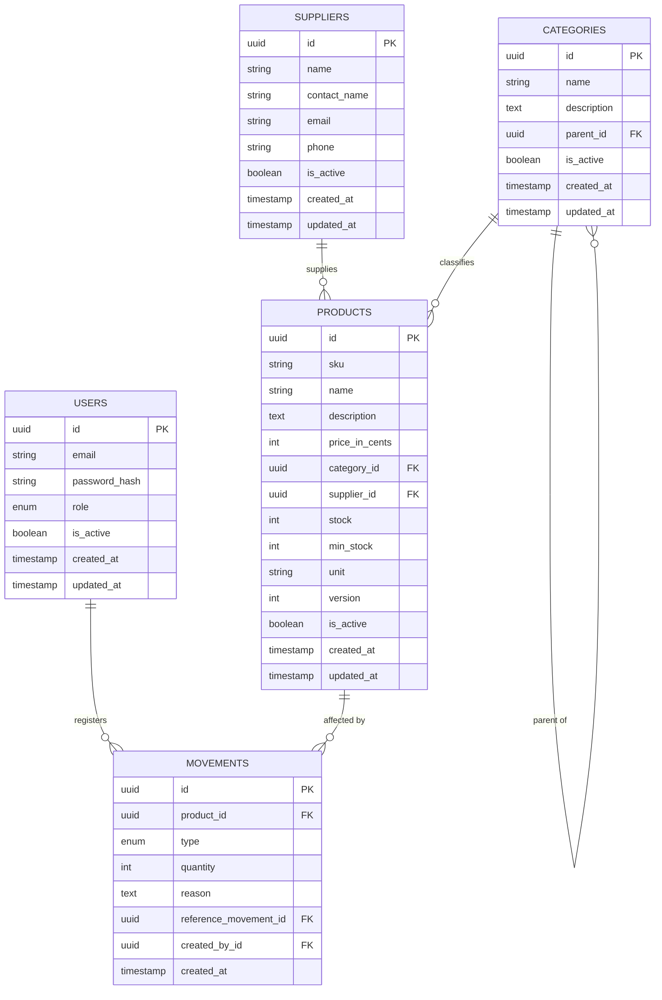

# 03 — Data Model

&gt; Database design for `inventory-api`.
&gt; Status: 📝 Draft | Last revised: 2026-10-20
&gt; DBMS: PostgreSQL 16 | ORM: Prisma

---

## 1. Entity Relationship Diagram

## 2. Tables

### 2.1 `users`
System accounts with role-based access.

| Column | Type | Constraints | Notes |
|---|---|---|---|
| `id` | UUID | PK, default `gen_random_uuid()` | |
| `email` | VARCHAR(255) | UNIQUE, NOT NULL | Lowercased by the application before insert. |
| `password_hash` | TEXT | NOT NULL | bcrypt output, never the plain password. |
| `role` | ENUM(`ADMIN`,`MANAGER`,`EMPLOYEE`) | NOT NULL, DEFAULT `EMPLOYEE` | |
| `is_active` | BOOLEAN | NOT NULL, DEFAULT true | Soft deletion for users. |
| `created_at` | TIMESTAMPTZ | NOT NULL, DEFAULT now() | |
| `updated_at` | TIMESTAMPTZ | NOT NULL, DEFAULT now() | |

### 2.2 `categories`
Product classification, with optional hierarchy.

| Column | Type | Constraints | Notes |
|---|---|---|---|
| `id` | UUID | PK | |
| `name` | VARCHAR(120) | NOT NULL | Unique among siblings is **not** enforced at DB level; validated in app to keep the rule flexible (rename "Bebidas" under two parents). |
| `description` | TEXT | NULL | |
| `parent_id` | UUID | FK → `categories.id`, NULL | NULL = root category. |
| `is_active` | BOOLEAN | NOT NULL, DEFAULT true | Soft delete. Deactivating a parent does **not** cascade (documented behavior). |
| `created_at` | TIMESTAMPTZ | NOT NULL, DEFAULT now() | |
| `updated_at` | TIMESTAMPTZ | NOT NULL, DEFAULT now() | |

### 2.3 `suppliers`

| Column | Type | Constraints | Notes |
|---|---|---|---|
| `id` | UUID | PK | |
| `name` | VARCHAR(150) | NOT NULL | |
| `contact_name` | VARCHAR(150) | NULL | |
| `email` | VARCHAR(255) | NULL | Format validated at app level. |
| `phone` | VARCHAR(30) | NULL | Free format, validated loosely. |
| `is_active` | BOOLEAN | NOT NULL, DEFAULT true | Soft delete. |
| `created_at` | TIMESTAMPTZ | NOT NULL, DEFAULT now() | |
| `updated_at` | TIMESTAMPTZ | NOT NULL, DEFAULT now() | |

### 2.4 `products`

| Column | Type | Constraints | Notes |
|---|---|---|---|
| `id` | UUID | PK | |
| `sku` | VARCHAR(64) | UNIQUE, NOT NULL | Immutable after creation. |
| `name` | VARCHAR(150) | NOT NULL | |
| `description` | TEXT | NULL | |
| `price_in_cents` | INTEGER | NOT NULL, CHECK ≥ 0 | Money as integer cents. Never float. |
| `category_id` | UUID | FK → `categories.id`, NOT NULL | |
| `supplier_id` | UUID | FK → `suppliers.id`, NULL | NULL = no preferred supplier. |
| `stock` | INTEGER | NOT NULL, DEFAULT 0, CHECK ≥ 0 | Denormalized counter. See decision D1. |
| `min_stock` | INTEGER | NOT NULL, DEFAULT 0, CHECK ≥ 0 | Threshold for low-stock alerts. |
| `unit` | VARCHAR(20) | NOT NULL | Validated free text: `unit`, `kg`, `g`, `liter`, `ml`, `box`, `pack`. |
| `version` | INTEGER | NOT NULL, DEFAULT 1 | Optimistic locking. See decision D2. |
| `is_active` | BOOLEAN | NOT NULL, DEFAULT true | Soft delete. |
| `created_at` | TIMESTAMPTZ | NOT NULL, DEFAULT now() | |
| `updated_at` | TIMESTAMPTZ | NOT NULL, DEFAULT now() | |

### 2.5 `movements`
The audit trail. **This table has no `updated_at` and no `is_active`: rows are immutable.**

| Column | Type | Constraints | Notes |
|---|---|---|---|
| `id` | UUID | PK | |
| `product_id` | UUID | FK → `products.id`, NOT NULL | Indexed with `created_at`. |
| `type` | ENUM(`IN`,`OUT`,`ADJUSTMENT`) | NOT NULL | |
| `quantity` | INTEGER | NOT NULL, CHECK &gt; 0 | Always positive; direction comes from `type`. |
| `reason` | TEXT | NOT NULL for `ADJUSTMENT`, NULL otherwise | Motive for manual adjustments. |
| `reference_movement_id` | UUID | FK → `movements.id`, NULL | For corrective adjustments: points to the original movement. |
| `created_by_id` | UUID | FK → `users.id`, NOT NULL | Who recorded it. |
| `created_at` | TIMESTAMPTZ | NOT NULL, DEFAULT now() | Immutable. |

## 3. Relationships and integrity rules

1. `products.category_id` and `products.supplier_id` are **hard FKs** — referential integrity at the DB level, not just the app.
2. FK constraints use `ON DELETE RESTRICT`: physical deletion of a category/supplier/product with related rows is impossible. Deactivation (soft delete) is the only path.
3. `movements.reference_movement_id` is self-referential and nullable; it exists only for `ADJUSTMENT` rows.
4. A movement's effect on `products.stock` is applied **only** by the application inside a transaction; there are no DB triggers. Rationale: business rules (rejection of negative stock, role checks) belong in the application layer where they can be tested and versioned.

## 4. Indexes

| Table | Index | Purpose |
|---|---|---|
| `users` | `(email)` | UNIQUE — login lookup. |
| `products` | `(sku)` | UNIQUE — product lookup. |
| `products` | `(category_id)` | Filter by category. |
| `products` | `(supplier_id)` | Filter by supplier. |
| `products` | `(stock)` partial: `WHERE stock &lt;= min_stock` | Low-stock report without full scan. |
| `categories` | `(parent_id)` | Tree traversal. |
| `movements` | `(product_id, created_at DESC)` | Product movement history (most common query). |
| `movements` | `(created_at)` | Date-range reports. |
| `movements` | `(type, created_at)` | Reports by movement type. |
| `movements` | `(created_by_id)` | "Movements by user" audit queries. |

## 5. Key design decisions

### D1 — `products.stock` is a denormalized counter, not a derived value
Stock *could* be computed as `SUM` of movements, but that forces an aggregation
on every read and degrades as history grows. Instead:
- `stock` is an integer counter updated **atomically inside the same
  transaction** that inserts the movement.
- `movements` remains the **source of truth / audit trail**: the counter can
  always be rebuilt from it (`ADJUSTMENT` types make the math exact).
- A future consistency-check job can compare counter vs. derived value.

### D2 — Optimistic locking with `products.version`
Concurrent `OUT` movements on the same product could interleave and bypass the
stock check. Two options:
- **Pessimistic lock** (`SELECT ... FOR UPDATE`): correct, but serializes
  writers per row and can deadlock under load.
- **Optimistic locking**: the UPDATE is `WHERE id = ? AND version = ?` and
  increments `version`; if 0 rows are affected, the transaction retries or
  returns 409. Chosen for the MVP: no lock contention, and conflicts surface
  as explicit failures.

The `stock &gt;= 0` CHECK constraint is the final safety net regardless of
application logic.

### D3 — Movement direction is a type, not a signed quantity
`quantity` is always positive; `type` provides direction. This prevents
double-negation bugs (`IN` of `-5`) and makes aggregations by type trivial.

### D4 — Money is integer cents (`price_in_cents`)
Floating point cannot represent decimal money exactly. Prices are stored as
integer cents (e.g. `$19.99` → `1999`) and formatted at the API boundary.

### D5 — Soft delete via `is_active`, everywhere except `movements`
Deactivation preserves referential integrity and history. `movements` cannot
be deleted at all — they are the audit trail.

## 6. Prisma notes (implementation hints)

- Enums map 1:1 to PostgreSQL `ENUM` types (`role`, `type`).
- `@updatedAt` handles `updated_at` automatically.
- The CHECK constraints (`stock &gt;= 0`, `quantity &gt; 0`) must be added via raw
  migration SQL, as Prisma has no native CHECK support.
- Partial index for low stock requires `@@index` with raw SQL in migration.

## 7. Open questions

| # | Question | Proposed answer |
|---|---|---|
| Q1 | Can a product be deactivated while `stock &gt; 0`? | Block it: force an `ADJUSTMENT` to 0 first. Keeps inventory honest. |
| Q2 | Can a category with active children be deactivated? | Warn but allow; children remain active and filterable by their own state. |
| Q3 | Should `users.email` changes be allowed? | Yes, with re-verification out of scope (no email service in MVP). |